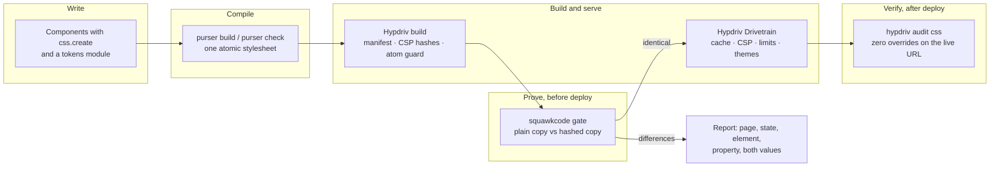

# Ecosystem: Hypdriv, Purser CSS and SquawkCode

Hypdriv has two sister products from Avonao. [Purser CSS](https://github.com/avonao/purser) changes how a site is styled. [SquawkCode](https://github.com/avonao/squawkcode) proves that a change to the CSS did not change how the site looks. Hypdriv serves, protects and observes the result. Each one works on its own. Together they cover the life of a stylesheet from the first line of component code to the audit of the live deployment.

All three are 0.1.0 Preview releases under the MIT license, distributed as source and tarballs, and none of them requires the others.

## Contents

- [At a glance](#at-a-glance)
- [How the three work together](#how-the-three-work-together)
- [Purser CSS](#purser-css)
- [SquawkCode](#squawkcode)
- [Hypdriv and Purser in detail](#hypdriv-and-purser-in-detail)
- [SquawkCode with Purser and Hypdriv](#squawkcode-with-purser-and-hypdriv)
- [Adoption paths](#adoption-paths)
- [An end-to-end pipeline](#an-end-to-end-pipeline)
- [Compatibility across the three](#compatibility-across-the-three)
- [Install the three Preview builds](#install-the-three-preview-builds)
- [Status and constraints](#status-and-constraints)
- [Questions and answers](#questions-and-answers)
- [Links](#links)

## At a glance

| | **Hypdriv** | **Purser CSS** | **SquawkCode** |
| --- | --- | --- | --- |
| **What it is** | A sidecar for performance, security and observability | A compiler for atomic CSS in which overrides cannot happen | A proof tool for CSS changes: class-name hashing plus a computed-style comparison |
| **One-line promise** | The same Drivetrain pipeline in front of Next.js and Vite hosts on Cloudflare Workers, Vercel and Node | No overridden declaration, no `!important`, no raw color, ever | Not one computed style changed, proven in headless Chrome |
| **Runs when** | At build time (manifest, CSP hashes) and on every request | At build time; the runtime only joins class names | Before deploy, on a copy of the site |
| **Touches your source** | Through the framework's documented extension points | Reads it statically, writes one stylesheet | Never: works on a copy |
| **Output** | Responses with cache, CSP, security headers, rate limits, traces; `.hypdriv/manifest.json` | One generated stylesheet in cascade layers, class names | A hashed copy of the site, `squawkcode-map.json`, a pass or fail with every differing element |
| **Command** | `hypdriv` (17 commands) | `purser` (`build`, `check`) | `squawkcode` (`init`, `transform`, `compare`, `gate`) |
| **Package** | `hypdriv`, `@hypdriv/*` (26 packages) | `@avonao/purser` (one package, three entry points) | `squawkcode` (one package, no build step) |
| **Node.js** | 20.9+ (some framework packages need 22+) | 22+ | 22+ |
| **Runtime dependencies** | Platform services optional | None | None |
| **Tests** | 1,543 in 156 files | 88 in 14 files, including headless Chrome | 12 in 2 files |
| **Repository** | [avonao/hypdriv](https://github.com/avonao/hypdriv) | [avonao/purser](https://github.com/avonao/purser) | [avonao/squawkcode](https://github.com/avonao/squawkcode) |
| **Homepage** | | [pursercss.dev](https://pursercss.dev) | |
| **Status** | 0.1.0 Preview | 0.1.0 Preview | 0.1.0 Preview |
| **License** | MIT | MIT | MIT |

## How the three work together



| Stage | Tool | What happens | What you get |
| --- | --- | --- | --- |
| Write | **Purser** | Styles sit next to components. Values are static. Colors are tokens. | Type errors for raw colors and unsafe shorthands |
| Compile | **Purser** | The build proves that no two rules for one property can match one element, then writes one stylesheet. `purser check` does the same without writing. | A deterministic stylesheet; `file:line:column` diagnostics; a failing CI step |
| Build | **Hypdriv** | `withHypDriv` awaits the Purser build before Turbopack or webpack starts. The chained adapter writes the route manifest and CSP hashes and checks that every Purser class the prerendered HTML uses exists in the stylesheet. | `.hypdriv/manifest.json` with atoms per route and unused atoms; a build that fails on a stale stylesheet |
| Prove | **SquawkCode** | The project is copied, class names are hashed in the copy, both copies are built and served, and headless Chrome compares every element's computed style in every configured page, viewport, state and action. | Exit 0 only when identical; the hashed tree to deploy |
| Serve | **Hypdriv** | The Drivetrain runs in front of the application: edge cache, CSP nonces and hashes, security headers, rate limits, bot shield, flags, flashless themes, Early Hints, tracing. | Responses with `Server-Timing` per stage |
| Verify | **Hypdriv** | `hypdriv audit css` crawls the routes in the manifest in headless Chrome at three widths and in default, hover and focus states, running Purser's `strike-count.js`. | A failing CI step if any declaration is struck through |

### Which tool answers which question

| Question | Tool |
| --- | --- |
| How do I write styles so that nothing can override anything? | Purser |
| Does my stylesheet still match my components? | Purser (`purser check`) and Hypdriv (the unstyled-atom guard) |
| Did moving this page from old CSS to Purser change how it looks? | SquawkCode (`compare`) |
| Can I shorten and obscure my class names without changing the look? | SquawkCode (`gate`) |
| Is anything struck through on the deployed site? | Hypdriv (`audit css`) |
| How do I avoid a flash of the wrong theme? | Hypdriv (the `theme` stage reads Purser's axes) |
| Which Purser atoms does each route use, and which are dead? | Hypdriv (`hypdriv routes --css`, `manifest.purser`) |
| How do I serve the site fast and safely on Cloudflare Workers, Vercel or Node? | Hypdriv |

### What each one does not do

- **Purser** does not serve, cache or secure anything, has no bundler plugin and does not compare two versions of a site. It guarantees there are no overrides only inside its own stylesheet.
- **SquawkCode** is not a security feature: hashed class names hide nothing a browser cannot read. It checks only the pages, states and actions you configure, and only in Chrome.
- **Hypdriv** does not compile CSS and never modifies Purser (ADR 0009). It consumes Purser's build API and its strike-count script, and degrades to a clear diagnostic when Purser is not installed.

## Purser CSS

[Purser CSS](https://github.com/avonao/purser) (`@avonao/purser`, homepage [pursercss.dev](https://pursercss.dev)) is a **compiler**. You write styles in TypeScript or JavaScript next to your components. The build reads them statically and writes one deterministic atomic stylesheet; the runtime only joins class names. It starts from rules about the output and makes them impossible to break.

### The guarantees

1. **No declaration is overridden** on the element it applies to, in any state and at any viewport width. Each build proves this by brute force, and a headless-Chrome test checks it in a real browser.
2. **No `!important`**, anywhere.
3. **Every color is a token.** A raw color in a component style is a type error and a build error.
4. **Every color in the output is `lab()`**, converted exactly with CSS Color 4 math (D50).
5. **Each declaration is written once.** Identical definitions share a class; output is deterministic; class names are short stable hashes (`x` plus seven base-36 characters).
6. **One generated stylesheet** in three cascade layers (`purser.tokens`, `purser.globals`, `purser.atoms`), plus `purser.overrides` for a project still moving from existing CSS.

### How it works

The runtime (`css.create`, `css.props`) normalizes each style and hashes it into class names. The build (`purser build`, `@avonao/purser/build`) parses your source with your project's TypeScript, evaluates every `css.create`, `css.keyframes`, `css.globals` and the tokens module, and compiles the result through the stages `extract → load tokens → normalise → compile conditions → prove exclusivity → render → write → self-check`. Conditional values (`:hover`, attributes, `@media`, `@supports`, `@container`) are rewritten into rules that are mutually exclusive by construction, so a later branch never has to override an earlier one. Details: [how Purser works](https://github.com/avonao/purser/blob/main/docs/how-it-works.md).

### Programming interface

| Call | What it does |
| --- | --- |
| `defineTokens({ axes, tokens })` | Declares tokens over theme axes (mode, contrast, wallpaper, motion or your own); returns typed `t.color.*`, `t.space.*` values |
| `css.create({ name: style })` | Declares named styles with static values and conditional branches |
| `css.props(...styles)` | Merges styles left to right and returns the class string |
| `css.keyframes(frames)` | Declares keyframes; returns the animation name |
| `css.globals(rules, options?)` | Rules that cannot be classes (`:root`, `body`, a reset, `::selection`, `@font-face`), made exclusive with each other and with atoms |
| `createCss({ prefix, salt })` | A `css` with custom naming |
| `build`, `check`, `watch`, `createBuilder` | The build API from `@avonao/purser/build` |

```tsx
import { css } from '@avonao/purser';
import { bp, t } from '@/lib/tokens';

const s = css.create({
  card: {
    padding: t.space[4],
    color: { default: t.color.text, ':hover': t.color.accent },
    display: { default: 'block', [bp.md]: 'flex' },
  },
});

export const Card = () => <div className={css.props(s.card)} />;
```

```sh
npx purser build --project . --src app,components,lib --tokens lib/tokens.ts --out app/purser.css
npx purser check --project . --src app,components,lib --tokens lib/tokens.ts   # CI: exit 1 on any violation
```

### Requirements and limits

Node.js 22+ (a TypeScript tokens module needs 22.18+; otherwise write `tokens.js`), TypeScript 5.0+ in your project, PostCSS 8.4+ optional (a self-check of the output). The stylesheet uses `lab()` and cascade layers: Chrome and Edge 111, Firefox 113, Safari 15.4 or later. Purser has no configuration file: every option is a CLI flag or a build option. Full reference: the [Purser README](https://github.com/avonao/purser#readme), [API](https://github.com/avonao/purser/blob/main/docs/api.md) and [Next.js guide](https://github.com/avonao/purser/blob/main/docs/nextjs.md).

## SquawkCode

[SquawkCode](https://github.com/avonao/squawkcode) is a **proof tool for CSS**, previously named ClassHash. It does two things that belong together. It rewrites the class names of a site to short hashes in a *copy* of the source. And it compares the computed style of every element of two running copies of a site in headless Chrome. The first is the change; the second is the evidence that the change did not alter how the site looks.

It never touches your source tree, and it **fails closed**: a string it cannot classify, or a class built at run time, is reported and stops the run instead of being guessed.

### What it does

| Capability | Detail |
| --- | --- |
| **Hashing** | One class map for the whole project; deterministic, collision-checked names (same seed and class give the same hash, so browser caches survive a redeploy); CSS rewritten with PostCSS, TS/TSX/JS/JSX with the TypeScript AST, `class="…"` in MDX, HTML and Markdown; selectors inside `querySelector`, `closest` and `matches` and helpers such as `clsx`, `cn`, `cx` and `cva` understood |
| **Safe by default** | Classes defined in CSS outside `srcDirs`, or named in source outside it, are kept automatically; Tailwind utilities and third-party widgets go in `keep` |
| **Computed-style compare** | Every element and every rendered pseudo-element of two running copies, per page, viewport, html-class state (light, dark, high contrast, …), scripted action and hover; one hash per element, full values only for the elements that differ; a difference counts only when it persists on a retry |
| **Honest comparison** | Colors written differently count as equal inside a tolerance (ΔE 0.02 in lab); properties one browser does not know are reported and left out; reduced motion, scrolling through lazy content, settling, and transitions cancelled so a capture never catches an animation half way |
| **Gate** | `squawkcode gate` copies, maps, rewrites, builds the plain and the hashed copy, serves both and compares them; exit 0 only when identical; the hashed tree it prints on PASS is the one to deploy |

### Commands

| Command | Purpose |
| --- | --- |
| `squawkcode init` | Write a starter `squawkcode.config.json` |
| `squawkcode transform` | Copy the project, hash class names in the copy, write `squawkcode-map.json`; exit 1 on anything it cannot rewrite with certainty |
| `squawkcode compare` | Headless-Chrome computed-style diff of two running sites: `--a <baseUrl> --b <baseUrl>` |
| `squawkcode gate` | Transform, build both copies, serve both and compare |

`compare` is not tied to hashing: it checks any CSS change, such as a move from one stylesheet architecture to another, against a known-good copy of the site.

### What it will not guess at

| Issue | Meaning | Resolve with |
| --- | --- | --- |
| `ambiguous-string` | A string that equals a class name but is not clearly a class | `ambiguous` in the config, or rewrite the source |
| `dynamic-class` | A class assembled with a template string | `keepPrefixes`, or rewrite the source |
| `escaped-class` | A class name with escapes in CSS | Rename the class, or keep it |
| `class-attribute-selector` | A selector that reads class text, such as `[class*="slide-"]` | Rewrite the selector, or keep the classes it reads |

### Requirements and limits

Node.js 22+; a local Chrome or Chromium (`SQUAWKCODE_CHROME` or `compare.chrome` names it); `postcss` and `typescript` installed in the project being processed, because SquawkCode resolves them from there; a `build.cmd` and a `serve.cmd` for the site. It does not care what framework made the site. Verified on a Next.js 16 site. Reference: the [SquawkCode README](https://github.com/avonao/squawkcode#readme) lists every configuration key.

### Why the name

A squawk code is the four-digit code that air traffic control assigns to an aircraft and that the pilot sets on its transponder: a few digits stand in for an identity. SquawkCode hashes every class name to a short code, and its comparison is the radar sweep: both copies answer for every element, and any element whose answer does not match is flagged.

## Hypdriv and Purser in detail

Hypdriv makes Purser first-class in a Next.js 16 project without touching Purser itself. The bridge is `@hypdriv/purser`; the Next.js integration (`withHypDriv`) and the CLI use it. Purser is an optional dependency of the host project: nothing in Hypdriv imports it statically, and every tool reports a clear `E_UNSUPPORTED` with install instructions when it is missing. The boundary is recorded in [ADR 0009](adr/0009-purser-boundary.md).

### What the bridge adds

| Capability | Where it runs | Detail |
| --- | --- | --- |
| **In-process build and watch** | `next build`, `next dev` (Next.js) | `next build` awaits `purser build` before Turbopack or webpack starts; Purser errors fail the build with their `file:line:col` diagnostics. `next dev` starts one `purser build --watch` and shows diagnostics in the DevTools HUD. No background shell process, no stale CSS. |
| **Unstyled-atom guard** | Build (Next.js adapter; the Vite hosts' build engine) | Every Purser class referenced by prerendered HTML (and RSC payloads) must exist in the stylesheet. A missing atom means the stylesheet is stale or a component bypassed the build. `purser.verify` is `'error'`, `'warn'` or `'off'`. |
| **Atom usage report** | Build, `hypdriv routes --css` | The manifest stores `purser.atomsByRoute` and `purser.unusedAtoms`, the stylesheet hash and size, and `missingAtoms` per route. |
| **Flashless themes** | Request, the `theme` stage | Each theme axis is resolved from the `hyp_theme` cookie or the `Sec-CH-Prefers-Color-Scheme` / `Sec-CH-Prefers-Contrast` client hints, and the axis classes are pinned on `<html>` with `HTMLRewriter` before the HTML leaves the edge: no inline script, no flash, CSP-clean. `Accept-CH`, `Critical-CH` and `Vary` are emitted. Where there is no Worker, a deterministic fallback script (`buildThemeScript`) is available and its hash joins the static CSP automatically. |
| **Early Hints** | Request (Next.js) | The stylesheet chunk that holds Purser's output is hinted on every route. |
| **Zero-override audit** | `hypdriv audit css --url <base>` | Headless Chrome crawls the routes in the manifest at 360, 768 and 1280 px in default, hover and focus states and runs Purser's `strike-count.js`. Any struck-through declaration fails the audit. |
| **Layer coexistence** | `layerStatement()` | Prints the ordered `@layer` statement that places Purser's tokens and globals below existing CSS (Tailwind, legacy) and its atoms above it. |
| **CLI** | `hypdriv css build`, `check`, `watch` | The same Purser operations without Next.js. |
| **Doctor** | `hypdriv doctor` | Checks `purser.configured`, `purser.installed`, `purser.tokens`, `purser.stylesheet-import`, `purser.check` and `purser.verification`, and detects a TypeScript 7 host. |

### Configuration

```ts
// hypdriv.config.ts
import { defineConfig } from 'hypdriv';

export default defineConfig({
  purser: {
    tokens: 'lib/tokens.ts',          // auto-detected from lib/tokens.ts, lib/tokens.js, src/lib/tokens.ts, app/tokens.ts, tokens.ts
    src: ['app', 'components', 'lib'], // default
    out: 'app/purser.css',             // default; import it once in app/layout.tsx
    prefix: 'x',                       // must match createCss({ prefix }) when you use a custom css instance
    verify: 'error',                   // unstyled-atom guard: 'error' | 'warn' | 'off'
    theme: {
      cookie: 'hyp_theme',
      axes: {
        mode: {
          classes: { light: null, dark: 'dark' },
          default: 'light',
          clientHint: { hint: 'prefers-color-scheme', values: { dark: 'dark', light: 'light' } },
        },
      },
    },
  },
});
```

Every `purser.*` option maps onto Purser's build options (`projectDir`, `src`, `tokens`, `out`, `prefix`, `salt`, `packageName`, `cssModule`, `layers`). The complete guide, including the manifest section, theme resolution and the stage's position in the Drivetrain, is [Purser CSS with Hypdriv](guides/purser.md); the bridge package is documented in [`packages/purser`](../packages/purser).

### Which pieces work on which framework

| Piece | Next.js | Vite hosts (Vite, React Router, TanStack Start, Astro, SvelteKit, Nuxt, vinext) |
| --- | --- | --- |
| Generate the stylesheet | Automatic inside `withHypDriv` (build and dev watch) | Run `purser build` or `hypdriv css build` as a build step |
| Unstyled-atom guard and atom usage report | Yes | Yes, when `purser` is configured: the build engine verifies the built pages |
| Flashless themes | Yes | Yes: the `theme` stage is part of the shared pipeline whenever `purser.theme` is configured |
| Early Hints for the stylesheet | Yes | Not part of the Vite hosts' integrations |
| `hypdriv audit css` | Yes | Yes: it reads the project's manifest and runs against any URL that serves the site |

Scaffolded starting points: `create-hypdriv --purser` generates the Next.js `cloudflare-purser` and `vercel-purser` templates, and [`examples/with-purser`](../examples/with-purser) and [`examples/vercel-purser`](../examples/vercel-purser) are the runnable references.

### TypeScript 7

Purser needs TypeScript's programmatic API, which exists in TypeScript 5.x and 6.x. TypeScript 7 (the Go compiler) ships no stable programmatic API, so a TS 7 host needs `typescript@^6` or the `@typescript/typescript6` alias for the build step; the editor can keep using 7. `hypdriv doctor` detects this.

### Node.js version

Hypdriv's core packages run on Node 20.9+, but Purser itself needs Node 22+. A project that uses Purser therefore builds on Node 22 or later.

## SquawkCode with Purser and Hypdriv

SquawkCode has no code dependency on either sister product. They meet at three places.

### 1. Proving a move onto Purser

Moving an existing site onto Purser one component at a time is exactly the kind of change `squawkcode compare` proves. Serve the site before the move on one port and after it on another:

```sh
squawkcode compare --config squawkcode.config.json --a http://localhost:4401 --b http://localhost:4400
```

Every element's computed style, in every configured page, viewport, html-class state and action, is compared. A difference names the page, the element, the property and both values. Together with the cascade-layer method in the Purser docs (Purser's atoms above a `legacy` layer, its globals below), each component move is a small, checkable step: `strike-count.js` shows which declarations are still overridden, and SquawkCode shows that nothing changed visually.

### 2. Hashing before Hypdriv builds

`squawkcode gate` builds the hashed copy with your `build.cmd`. When that command is a Hypdriv build (`next build` with `withHypDriv`, or `vite build` with a Hypdriv integration), the manifest, the CSP hashes and the Early Hints are computed from the **hashed output**, so they are consistent with what is deployed. Deploy from the hashed tree that the gate prints on PASS.

Purser's atom classes are already short hashes (`x` plus seven characters). Keep them out of the SquawkCode class map: the generated stylesheet lives outside `srcDirs` when you point `srcDirs` at hand-written component directories, and CSS outside `srcDirs` is kept automatically; alternatively list the Purser prefix in `keepPrefixes`. The gate fails closed, so a mistake shows up as an issue or as a comparison difference rather than as a broken deployment.

### 3. Before and after deploy

| | SquawkCode | Hypdriv |
| --- | --- | --- |
| **Question** | Did this change alter the look? | Is the running site correct and free of overrides? |
| **When** | Before deploy, on two local copies | After deploy, on a URL |
| **Evidence** | Computed-style diff, per element | Headers, CSP, cache, HTTPS and CSS audits (`hypdriv audit all`), zero-override audit |
| **Scope** | The pages, states and actions you configure | The routes in the manifest |

They do not overlap: one stops a visual regression from shipping, the other confirms the shipped site behaves.

## Adoption paths

| You have | Start with | Add |
| --- | --- | --- |
| A new Next.js app | `create-hypdriv` with `--purser` (Cloudflare or Vercel) | Nothing else: Purser, the bridge and the audits are wired |
| An existing Next.js app on Cloudflare or Vercel | `hypdriv init`, then `hypdriv doctor` | Purser when you want guaranteed no-override CSS |
| An existing site with its own CSS that you want on Purser | Purser with a `legacy` layer, one component at a time | SquawkCode `compare` to prove each step; Hypdriv `audit css` on the deployment |
| Any site whose class names you want short and stable | SquawkCode `gate` | Hypdriv for the serving side |
| A Vite-based framework (Vite, React Router, TanStack Start, Astro, SvelteKit, Nuxt, vinext) | The framework's Hypdriv integration | Purser with `hypdriv css build` as a build step |
| A site that only needs a visual regression check between two versions | SquawkCode `compare` | Nothing |

## An end-to-end pipeline

An example continuous-integration job that uses all three, with the documented commands. It is an example, not a file shipped in any of the repositories; it needs a runner with Node 22+ and Chrome.

```yaml
# .github/workflows/release.yml (example)
name: Release gate
on:
  pull_request:
  push:
    branches: [main]

jobs:
  verify:
    runs-on: ubuntu-latest
    steps:
      - uses: actions/checkout@v5
      - uses: actions/setup-node@v5
        with: { node-version: 22 }
      - run: npm ci

      # Purser: validate styles without writing (exit 1 on any violation)
      - run: npx purser check --project . --src app,components,lib --tokens lib/tokens.ts

      # Hypdriv: configuration and project health
      - run: npx hypdriv doctor --ci

      # SquawkCode: build the plain and the hashed copy, serve both, compare every element
      # (`squawkcode` comes from a clone or a vendored copy while it is not on a registry)
      - run: squawkcode gate --project .

      # Hypdriv: audit the built site served locally (headers, CSP, cache, zero overrides)
      - run: |
          npx next start -p 3000 &
          npx wait-on http://localhost:3000
          npx hypdriv audit all --url http://localhost:3000
          npx hypdriv audit css --url http://localhost:3000
```

For a deployment, run the same `hypdriv audit` commands against the deployed URL (add `--header` for a preview gateway) after the deploy.

## Compatibility across the three

| | Hypdriv | Purser | SquawkCode |
| --- | --- | --- | --- |
| Version | 0.1.0 | 0.1.0 | 0.1.0 |
| Node.js | 20.9+ (Vite 20.19+; Astro, TanStack Start 22.12+; SvelteKit 22.17+; React Router 22.22+; vinext 22+) | 22+ | 22+ |
| TypeScript | 5.9 to 7 in host apps; 5.x or 6.x when Purser is used | 5.0+ in the project (5.x or 6.x: needs the programmatic API) | 5+ in the project being processed |
| Frameworks | Next.js 16+, Vite 8, React Router 8, TanStack Start, Astro 7, SvelteKit 3, Nuxt 4, vinext | None (works with any framework that imports a CSS file and accepts a `className` string); guide for Next.js 16 | Any site with a build command and a serve command; verified on Next.js 16 |
| Platforms | Cloudflare Workers, Vercel, Node | Wherever the CSS file is served | Local (build, serve and compare happen on your machine or CI) |
| Browsers or tools | Headless Chrome for `audit css` | Chrome 111+, Edge 111+, Firefox 113+, Safari 15.4+ for the output | Chrome or Chromium for the comparison |
| Cross-product contract | Uses `@avonao/purser` 0.1+ through `@avonao/purser/build` and `scripts/strike-count.js` | Public build API and the strike-count script are what Hypdriv consumes | None required |

## Install the three Preview builds

None of the three is on a package registry yet. Each installs from source or a tarball.

```sh
# Hypdriv: release bundle (tarballs, checksums, installer, docs). See the README.
git clone https://github.com/avonao/hypdriv.git && cd hypdriv
pnpm install && pnpm build
node scripts/release-bundle.mjs --out ../hypdriv-bundle
../hypdriv-bundle/install.sh path/to/your-app

# Purser: one tarball
git clone https://github.com/avonao/purser.git && cd purser
npm install && npm test
npm pack                                  # avonao-purser-0.1.0.tgz
cd path/to/your-app && npm install --save-dev ../purser/avonao-purser-0.1.0.tgz

# SquawkCode: run from a clone, or link it
git clone https://github.com/avonao/squawkcode.git && cd squawkcode
npm install && npm test
npm link                                  # puts `squawkcode` on your PATH
```

Commit the Purser tarball (for example in `vendor/purser/`) next to Hypdriv's `vendor/hypdriv/` so continuous integration installs the same bytes.

## Status and constraints

| | Hypdriv | Purser | SquawkCode |
| --- | --- | --- | --- |
| Release | 0.1.0 Preview | 0.1.0 Preview | 0.1.0 Preview |
| Implemented | Every capability in the [feature catalog](feature-catalog.md) | Everything in its README | Everything in its README |
| API stability | Not yet guaranteed; 1.0 commits to the config and manifest schemas | Not yet guaranteed; 1.0 commits to the style and token APIs and to class names | Not yet guaranteed; 1.0 commits to the configuration schema and the map format |
| Distribution | Source and release-bundle tarballs | Source and a packed tarball | Source |

Constraints that matter when the three are combined:

- **Purser's styles are static.** A value can use literals, the tokens module's exports, `const` bindings in the same file and `css.keyframes()` names. Use custom properties for runtime values.
- **One `css.props` call per element.** Adding Purser classes by hand, or setting a property that an atom also sets through the `style` prop, bypasses the merge and can override.
- **Purser covers only its own stylesheet.** Third-party CSS on the same elements can still override, and so can the browser's user-agent styles.
- **No bundler plugin for Purser yet.** Hypdriv's Next.js integration runs the build for you; elsewhere use the CLI, `hypdriv css build` or the build API.
- **SquawkCode is not a security feature**, and classes assembled at run time or set by third-party code must be listed in `keep` or `keepPrefixes`.
- **SquawkCode's coverage is yours to configure.** The comparison covers only the pages, states and actions you list, in Chrome. Sites that change on a timer need `beforeCapture` or `readyWhen`.
- **Hypdriv needs Node 22+ for the hosts and tools that Purser and SquawkCode also require**, so a project that uses all three standardizes on Node 22 or later.
- **A TypeScript 7 host** needs `typescript@^6` (or the `@typescript/typescript6` alias) for the Purser build.

Each product keeps its own list in its README under *Preview status*.

## Questions and answers

**Do I need all three?** No. Hypdriv works without Purser (Purser features then report "not installed" and everything else runs). Purser works without Hypdriv through its CLI and build API. SquawkCode works on any site, with or without either.

**Why separate products?** Each has a different job, release cadence and audience. Purser can be adopted in a project that is not served through Hypdriv; SquawkCode can check a change that has nothing to do with Purser. Hypdriv consumes Purser only through its public build API and never modifies it (ADR 0009), so neither side can break the other's internals.

**In which order do I adopt them?** Start with the problem you have. Moving styles: Purser first, SquawkCode to prove each step, Hypdriv to serve and audit. Serving and securing a site: Hypdriv first. Shortening class names: SquawkCode.

**Does SquawkCode work with Purser's class names?** Purser atoms are already short, stable hashes. Keep the generated stylesheet out of `srcDirs`, or list the Purser prefix in `keepPrefixes`, so SquawkCode leaves them alone, and use the gate to confirm.

**What does `hypdriv audit css` check that `squawkcode compare` does not?** `audit css` looks for overridden (struck-through) declarations on a running site. `compare` looks for any computed-style difference between two versions of a site. A page with no overrides can still look different from its predecessor, and a page that looks identical can still contain an override.

**Is any of this available on npm?** Not yet. All three are distributed as source and tarballs during the Preview.

## Links

| | Repository | Documentation |
| --- | --- | --- |
| Hypdriv | [avonao/hypdriv](https://github.com/avonao/hypdriv) | [README](../README.md) · [architecture](architecture.md) · [feature catalog](feature-catalog.md) · [Purser CSS with Hypdriv](guides/purser.md) · [CLI](guides/cli.md) |
| Purser CSS | [avonao/purser](https://github.com/avonao/purser) · [pursercss.dev](https://pursercss.dev) | [README](https://github.com/avonao/purser#readme) · [how it works](https://github.com/avonao/purser/blob/main/docs/how-it-works.md) · [API](https://github.com/avonao/purser/blob/main/docs/api.md) · [Next.js guide](https://github.com/avonao/purser/blob/main/docs/nextjs.md) · [changelog](https://github.com/avonao/purser/blob/main/CHANGELOG.md) |
| SquawkCode | [avonao/squawkcode](https://github.com/avonao/squawkcode) | [README](https://github.com/avonao/squawkcode#readme) · [changelog](https://github.com/avonao/squawkcode/blob/main/CHANGELOG.md) · [example configuration](https://github.com/avonao/squawkcode/blob/main/squawkcode.config.example.json) |
